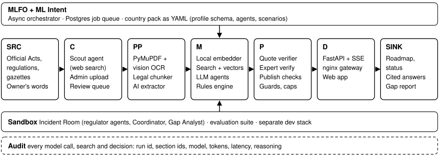

# Compliance Copilot

**AI for Good Sandbox Hackathon (UAE)**

- **Team:** Haumea
- **Member:** Ndabuye Gideon
- **Contact:** sndabuye@gmail.com
- **Live system:** https://compliance.nac.africa
- **Domain:** public services (business registration, licensing and compliance)
- **Countries:** Tanzania (English, Swahili) and the United Arab Emirates (Arabic, English)

## Summary
Small businesses must satisfy many regulators whose rules are scattered across laws, regulations and agency
websites. Compliance Copilot reads a country's official laws and procedure pages and turns them into a cited
knowledge base and a verified register of steps. Owners describe their business in their own words and get the
steps that apply, in the order the authorities require, with answers quoted from the law. Regulators get an
Incident Room, where agents playing institutions respond to a staged incident and surface unclear mandates.

- **Rules decide what applies, and the model explains it.**
- **Every legal claim quotes the law.** Code checks each quote word for word and removes figures the quote does not state.
- **People approve** every document and every step before users see it.
- **Everything is audited**, from model calls to searches and decisions, with section IDs and tokens.
- **Two countries are live** on the same agents and code, Tanzania (English and Swahili) and the United Arab
  Emirates (Arabic and English).

## Why existing options fall short
| Option | Problem | Compliance Copilot |
|---|---|---|
| Consultants | Costly and opaque | Free, every step cited |
| Agency portals | One agency each, with no order across agencies | All regulators in one register, with the links between steps |
| General chatbots | Invent fees and cite nothing | Quotes checked in code |

## Knowledge base
- **Tanzania.** 61 laws (55 Acts, 6 regulations), 6,871 sections, 47 regulators, 507 verified steps with 492
  links between them, and 1,764 citations. Sources are the Laws of Tanzania, Revised Edition 2023 (Office of the
  Attorney General, oagmis.oag.go.tz), and regulator sites.
- **United Arab Emirates (federal and Dubai).** 95 laws and official procedure pages (24 in Arabic), 4,465
  sections, 25 regulators, 189 verified steps with 154 links between them, and 589 citations. Arabic scans are
  read by OCR, and each law keeps its Arabic and English versions linked.
- Each document keeps its URL, issuing authority and SHA-256. One chunk per section or article, with its
  reference, heading path and pages, a full-text index and a 384-dimension vector in PostgreSQL with pgvector.
- Open export in [`kb/`](kb/), one folder per country (`TZ/`, `AE/`), with documents, sections, the verified
  register and the profile questions (each law links to its official copy).

## Architecture (ITU-T Y.3172)

| Node | Component |
|---|---|
| Source (SRC) | Official laws and procedure pages, and the owner's description |
| Collector (C) | Scout agent (web search on official domains), uploads and one review queue |
| Preprocessor (PP) | PDF reading, OCR for scans, splitting by section or article, AI drafting of steps |
| Model (M) | Local multilingual embedder with full-text search, DeepSeek agents and a JSON Logic rules engine |
| Policy (P) | Quote and figure Verifier, expert verification, publish checklist and spend caps |
| Distributor (D) and Sink (SINK) | Streaming API, gateway and web app, delivering the roadmap, cited answers and gap reports |
| ML Function Orchestrator (MLFO) and ML Sandbox | Orchestrator with a Postgres job queue, the Incident Room and the evaluation suite |

Stack: FastAPI, SQLAlchemy, PostgreSQL 17 + pgvector, React + Vite, Docker Compose (3 containers, ~0.7 GB RAM).

## Agents
Three groups. For owners, an Orchestrator and domain agents that answer from their own regulators' laws. For the
knowledge base, agents that find documents and draft steps for people to verify. For regulators, one agent per
institution in the Incident Room, with a Coordinator and a Gap Analyst. Each agent, its job and where it could be
reused are listed in Appendix A of the technical report. Details: [`agents/`](agents/).

## Evaluation
| Measure (Tanzania, 53 questions) | Same model, ungoverned | Compliance Copilot |
|---|---|---|
| Cites the section that answers | 0 | 52 |
| States a fee or time limit with no source | 8 | 3 |
| Resists pressure to give a figure (5 cases) | 1 | 5 |
| Ignores an instruction planted in a document (2 cases) | 1 | 2 |

| Rules check | Tanzania | UAE |
|---|---|---|
| Test businesses | 19 | 18 |
| Steps the law requires that appear on the roadmap | 100% | 100% |
| Steps wrongly applied | 0 of 53 | 0 of 96 |
| Order between steps broken | 0 of 12 | 0 of 73 |
| Answers citing the expected section | 52 of 53 | 14 of 16 (half in Arabic) |

## Policy and standards gaps (summary)
Each gap says how it was found, by **our agents** (the Incident Room run), **our pipeline** (counted across the
knowledge base) or **our analysis** (mapping the system to Y.3172 and to the law).

**Policy gaps**
1. **No regulator is in charge of AI that advises on legal duties.** Unclear responsibility, found by our agents.
   In the Incident Room each regulator took only its own part, and the Coordinator concluded "No law assigns AI
   advisory tools to any regulator." Compare the EU AI Act, Art. 70, and the UK's shared-regulator approach.
2. **The order between agencies is written down nowhere.** A coordination gap, found by our pipeline and analysis.
   We derived 492 links for Tanzania ourselves, and the UAE sequence appears only in portal guides. Compare the EU
   Single Digital Gateway, Art. 14.
3. **Fees and deadlines are kept outside the law.** A legislative gap, found by our pipeline. 122 sections in 33
   Tanzanian laws leave the fee to another document. Compare the EU Single Digital Gateway, Art. 10.
4. **Data-transfer permits are written for single transfers.** A legislative gap, found by our analysis. PDPA
   reg.20 asks for one permit per transfer, naming its date and time. Compare GDPR Arts. 45 and 46.
5. **Disclaimers clash with consumer protection.** A conflict between objectives, found by our analysis. The Fair
   Competition Act, s.27, voids terms that exclude consumer protection, and AI advisers rely on disclaimers.
6. **Official law is hard for machines to reach and read.** A technology gap, found by our pipeline. Laws are
   PDFs, some portals block automated access, and many Arabic PDFs needed OCR. Compare Akoma Ntoso and the OECD's
   Rules as Code.

**Standards gaps in Y.3172 and the Readiness Framework**, each with what we built
1. No way to show which source an answer came from. Our Verifier checks every quote against its section and
   records which sections each answer used.
2. No step for a person to approve. We approve every document, and experts verify every step.
3. No messages between agents. Our Incident Room agents send typed messages, and each one is logged.
4. Source text can carry instructions. We handle document and web text as data only.
5. Readiness metrics stop at whether guardrails exist. We propose measuring the share of claims backed by a cited
   section and the share of decisions fully traced.

**Next steps.** A contribution on these extensions to ITU-T Study Group 13, our Arabic OCR fix and legal splitter
offered to ITU's AI readiness reference code, short briefs to the Tanzanian regulators, each country's verified
steps as open data, and a paper. Details and sources are in the technical report.

## Credits and licence
Knowledge-base pipeline adapted from [CrashingGuru/ITUAIReadiness](https://github.com/CrashingGuru/ITUAIReadiness)
(MIT). Content in this repository: CC BY 4.0, see [LICENSE](LICENSE).
